# Tuition Takkar: Project Guide

The full context for this project, written so a new developer (or a new Claude session) can pick it up without the earlier conversations. Last updated **28 Oct 2026**, at commit `81a906c` on `main`.

**If you are Claude starting fresh,** read this whole file first. Then read [Working agreements](#16-working-agreements) and [Known issues and next steps](#15-known-issues-and-next-steps) before you change anything.

---

## Contents

1. [What the game is](#1-what-the-game-is)
2. [Quick facts](#2-quick-facts)
3. [Screenshots](#3-screenshots)
4. [How a match plays](#4-how-a-match-plays)
5. [Offline modes](#5-offline-modes)
6. [Economy: marks, pens, ink](#6-economy-marks-pens-ink)
7. [Online play](#7-online-play)
8. [Desks, levels and XP](#8-desks-levels-and-xp)
9. [Profile, stats and badges](#9-profile-stats-and-badges)
10. [Friends, invites and notifications](#10-friends-invites-and-notifications)
11. [Code map](#11-code-map)
12. [Editor menus](#12-editor-menus)
13. [Build, sign and install](#13-build-sign-and-install)
14. [Server setup (Unity Gaming Services and Firebase)](#14-server-setup-unity-gaming-services-and-firebase)
15. [Known issues and next steps](#15-known-issues-and-next-steps)
16. [Working agreements](#16-working-agreements)
17. [Decision log](#17-decision-log)

---

## 1. What the game is

**Tuition Takkar** is a mobile pen-fight game, the desk game Indian school kids play. You flick your pen across a desk to knock the other pen off without your own pen falling. It's inspired by penfight.xyz, but the name, art, UI, sounds and story are all original. The setting is a tuition class, and the look is a hand-drawn classroom: chalkboards, ruled paper, ballpoint and pencil sketches.

- **Platforms:** Android now. iPhone is planned, waiting on an Apple developer account.
- **Engine:** Unity 6 (6000.5.9f1), built-in render pipeline. All UI is UI Toolkit, built in code. There are no prefabs: the game builds the whole scene in code when it starts.
- **Offline:** Batch Ladder (an endless run of bot rivals), Practice vs bot, and Pass & Play (2–4 players on one phone).
- **Online:** Quick Match and private rooms for 2, 3 or 4 players, 28 desks with entry fees and pots, leaderboards, player profiles with badges, friends, room invites and push notifications.
- **Sign-in:** play as a guest straight away, or sign in with Google (Apple later, on iPhone only). Friends and the online profile are for signed-in players only.

---

## 2. Quick facts

| What | Value |
|---|---|
| Project folder (owner's Mac) | `~/Downloads/TutionTakkar` |
| Git | `github.com/VatsalPatadiya/TutionTakkar`, branch `main` (work is committed straight to `main`) |
| Unity | 6000.5.9f1, Android build target, portrait |
| Android package | `com.unitygame.tuitiontakkar` |
| Version | 1.0 (version code 1) |
| Unity Gaming Services | org `vatsalsoni1302`, project **TutionTakkar** `b3d37f39-33a9-4065-b2f8-a60042f4ef7c`, environment **production** `3b2c3e1a-611a-41a6-a2b2-117f01e0579e` |
| UGS used | Authentication, Lobby (Multiplayer Services), Leaderboards, Cloud Save, Cloud Code (JS), Friends, Secret Manager |
| Leaderboards | `total_wins` (all-time, Total score) and `weekly_wins` (Total score, resets weekly) |
| Cloud Code scripts | `friend_id`, `find_player`, `invite_push`, `friend_push` (all in `Assets/CloudCode/`) |
| UGS secret | `FCM_SERVICE_ACCOUNT` (Firebase service-account JSON, project-level, Cloud Code access) |
| Firebase project | `penfighter-6be8b` (push notifications, plus the invite-link landing page on Firebase Hosting) |
| Invite links | `https://penfighter-6be8b.web.app/join/ABC123?from=Name` and `tuitiontakkar://join/ABC123` |
| Friend notification links | `tuitiontakkar://friends` and `tuitiontakkar://friends/requests` |
| Release keystore | `Keystore/tuitiontakkar-release.keystore`, alias `tuitiontakkar`. **Not in git.** The owner keeps the password; never write it into any file. |
| Release SHA-1 | `F6:A9:C2:9B:45:72:97:60:C8:51:17:68:40:85:75:A2:CF:D2:66:9F` (already registered in Firebase) |
| Design mockups | A Claude Design canvas holds all the approved screen mockups. It's private to the owner's claude.ai account; ask the owner for screenshots if you need them. |

### Packages

`com.unity.services.authentication 3.8.0`, `multiplayer 2.4.1`, `leaderboards 2.3.4`, `cloudsave 3.4.2`, `cloudcode 2.10.4`, `friends 1.3.0`, `deployment`, `mobile.notifications 2.4.3`. Native Android code lives in `Assets/Plugins/Android/` (GoogleSignIn.androidlib and Push.androidlib). There's one iOS file: `Assets/Plugins/iOS/TTShare.mm`, the share sheet.

---

## 3. Screenshots

All taken from the Unity editor at phone size (1170 × 2532) with **Tuition Takkar → Dev: Save doc screenshots**. Run that menu in Play mode to retake them all.

| | | | |
|---|---|---|---|
| 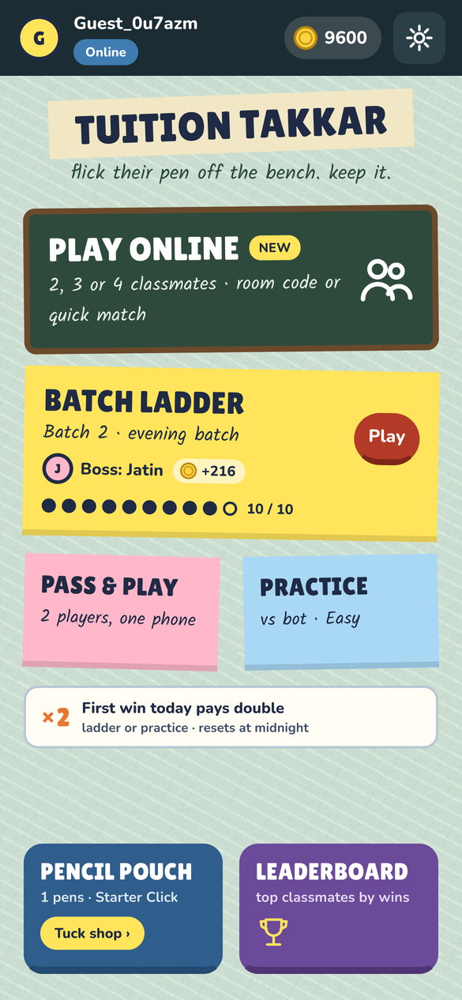 **Home** | 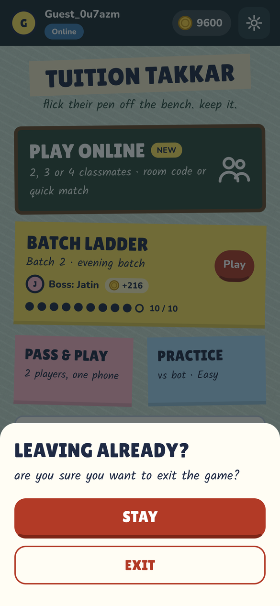 **Back gesture on Home** | 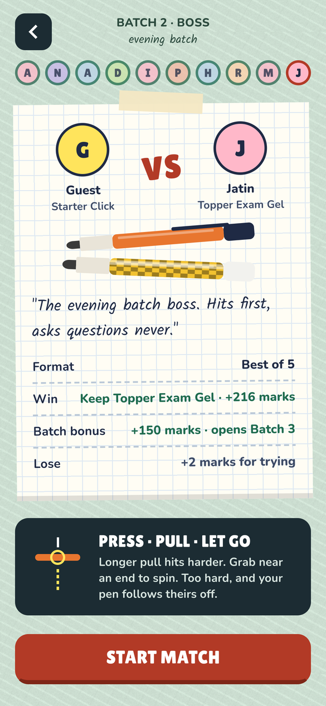 **Batch Ladder rival** | 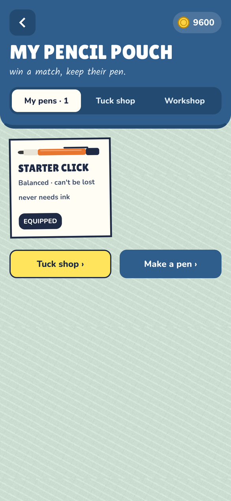 **Pouch: my pens** |
| 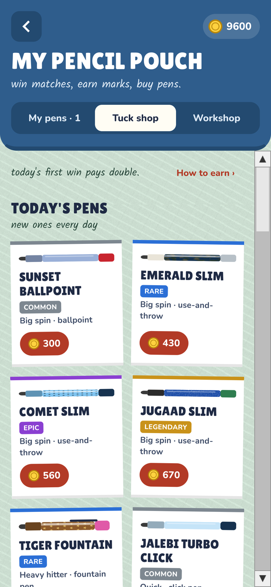 **Pouch: tuck shop** | 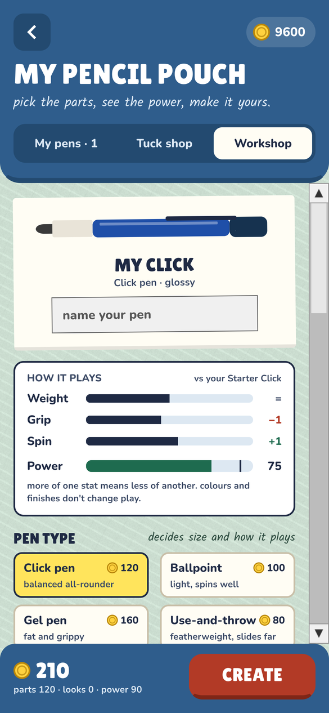 **Pouch: pen workshop** | 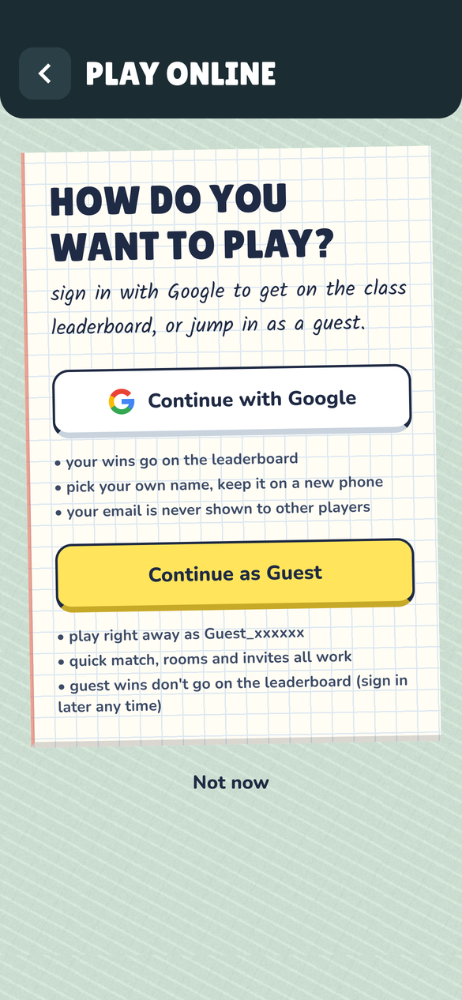 **Online: sign in or guest** | 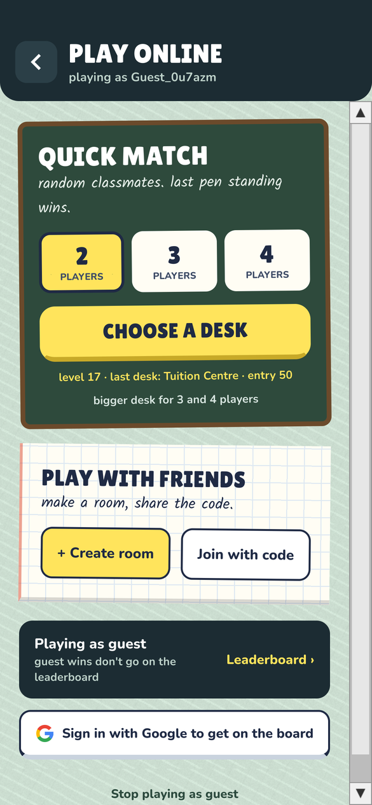 **Play Online (guest)** |
| 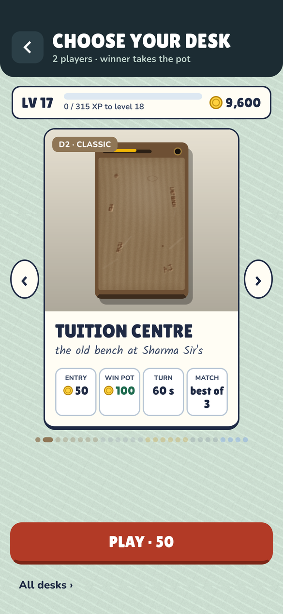 **Choose your desk** | 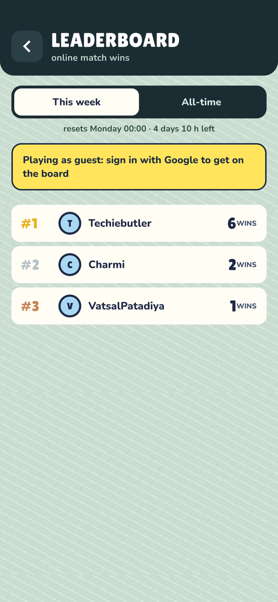 **Leaderboard** | 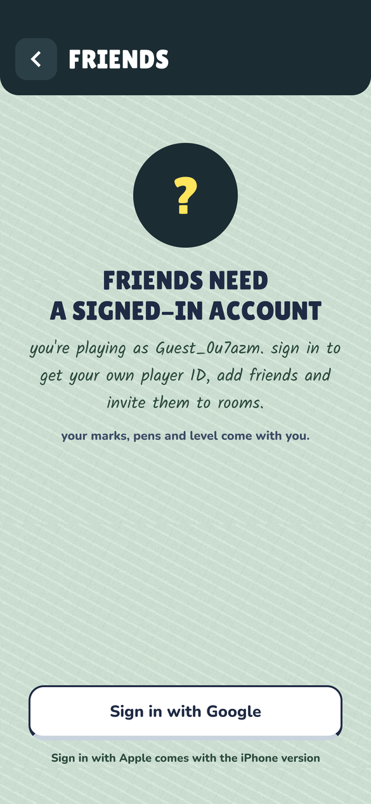 **Friends, guest locked out** | 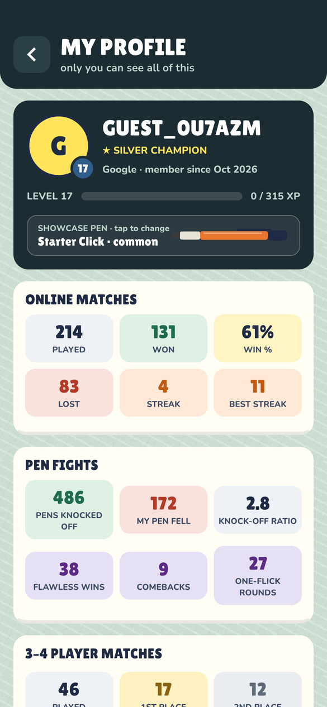 **My profile** |
| 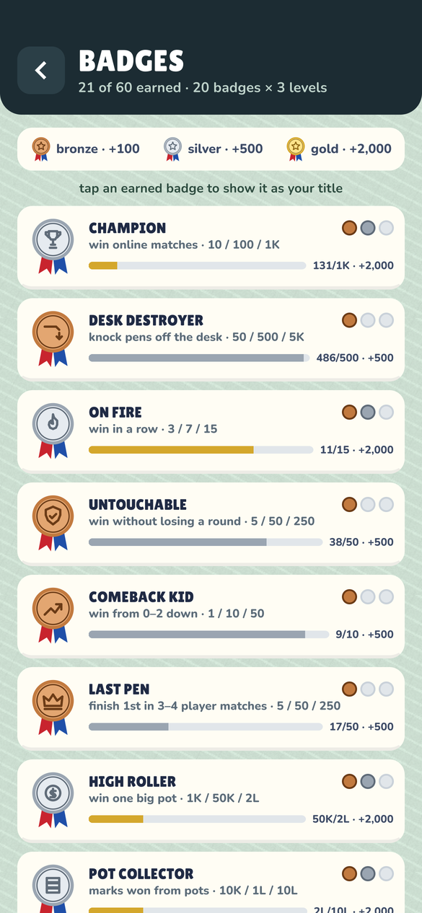 **Badges** | 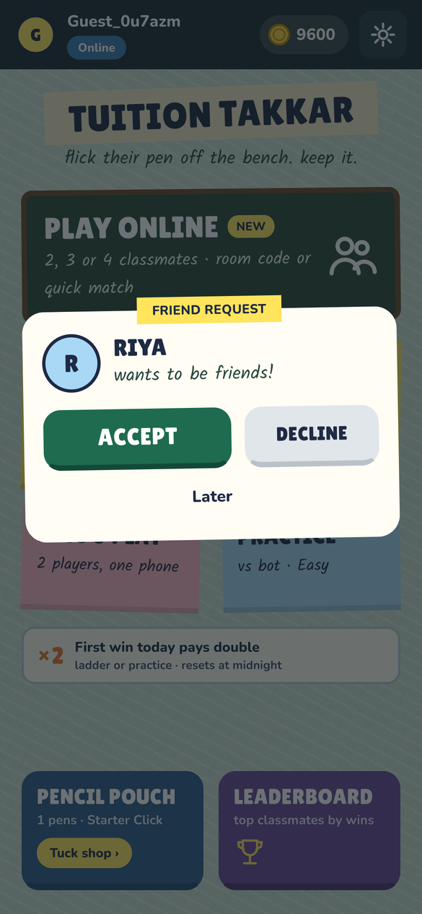 **Friend request popup** | 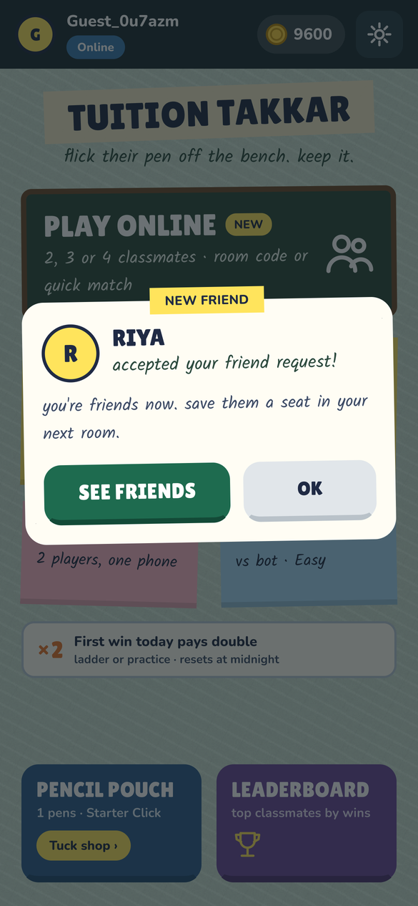 **Request accepted popup** | 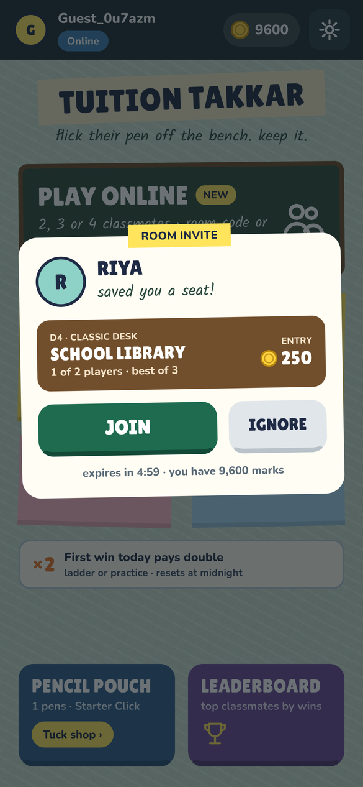 **Room invite popup** |
| 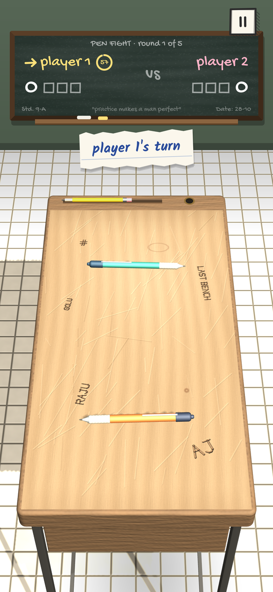 **Match, 2 players** | 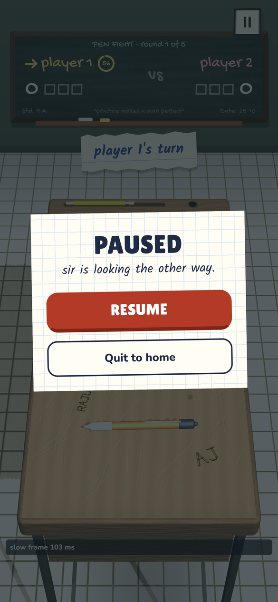 **Paused (offline)** | 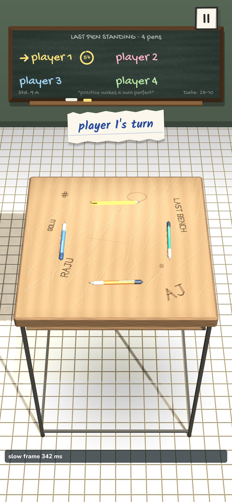 **Match, 4 players** | 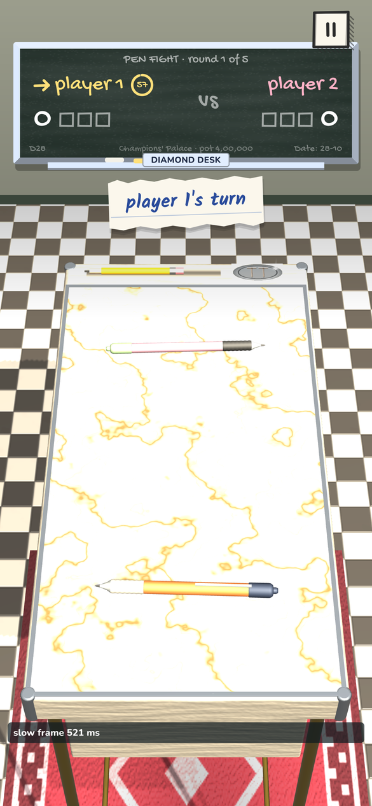 **D28 Champions' Palace desk** |

Not captured, because they need a live online session: the private room lobby, Quick Match "finding classmates", the online leave sheet, the online result screen, and the friends list with real friends.

---

## 4. How a match plays

- **Aim:** press on your pen, pull back, let go. A longer pull hits harder; full power is about 30% of the screen height. A pencil power ring follows your finger, and a dotted arrow shows the direction.
- **Spin:** grab near the tip or cap to spin the pen; grab the middle for a straight push.
- **Win a round:** knock their pen off the desk and keep yours on. If your own pen falls, you lose the round, even if theirs falls too. A pen hanging over the edge still counts as on; it's only out once it drops.
- **2 players:** best of 5 offline (best of 3 or 5 online, depending on the desk). The loser of a round shoots first in the next.
- **3–4 players:** one round, last pen standing.
- **Turn timer:** shown as a draining border. The desk glows red at the edge in the last 10 seconds.
- **Physics:** PhysX at 10× real scale (1 unit = 10 cm), with gravity and impulses scaled to match, which keeps small pens stable. All tuning is in `Scripts/Core/GameConfig.cs`. The pen motion was tuned against real pen-fight footage (Feel Lab menus).
- **Bot (`BotBrain`):** simulates a spread of flicks in a hidden physics scene, scores the outcomes, picks one, then adds human error from the rival's profile (aim error, power error, caution, aggression).
- **Feel:** all sounds are synthesised in code (`GameAudio`), so there are no audio files to license. Haptics are short pulses on Android, sent from a background thread. Fast pens get a motion streak, and there's slow-motion when a pen teeters on the edge.

---

## 5. Offline modes

| Mode | Details |
|---|---|
| **Batch Ladder** | Endless, in batches of 10 rivals. Batch 1 is hand-made (Monty … Vikram). From Batch 2 on, rivals are generated from a seed, so every player meets the same rivals. Rival 10 of each batch is the boss. You move forward only. Beat a rival to keep their pen and earn marks. |
| **Practice** | A bot on Easy, Medium or Hard. Wins pay 10/20/35 marks. |
| **Pass & Play** | 2–4 players on one phone. Pays nothing, so marks can't be farmed. |
| **Reminders** | Local notifications at 7 PM, at most one a day, none after 7 days away. They cover: ink low, the double-marks win, a rival waiting, "your pens are gathering dust", and a 50-mark welcome-back bonus (`Feel/Reminders.cs`). |

---

## 6. Economy: marks, pens, ink

All numbers live in `Scripts/Core/Economy.cs`.

- **Marks** are the currency. New players start with 100.
- **Earning:**
  - Practice: 10/20/35 by difficulty.
  - Ladder: the rival's reward (half on a rematch), plus their pen.
  - +5 per rival pen knocked off.
  - The first win of each day pays double.
  - A loss pays 2.
  - Online wins: 30 for a win and 10 for 2nd place in 3–4 player games, plus the desk pot.
- **Pens:**
  - There are classic pens plus **600 generated shop pens**, all built from parts.
  - Build parts (type, barrel, grip, cap) decide weight, grip and spin. Looks (colours, finish, pattern) are cosmetic.
  - Stats are capped by a power budget, so no pen is simply the best.
  - Players can design their own pen in the **Workshop**. A custom pen's id is a short code of its parts (`c.…`), so every phone in an online match rebuilds the same pen from the id alone.
- **Ink:** every pen except the Starter Click holds ink for 20 offline matches. An empty pen still plays, but with Starter Click stats, until it's refilled. A full refill costs about a third of the pen's price.
- **Pocket money:** 100 marks once a day, offered when you can't afford a desk.

---

## 7. Online play

`Scripts/Online/` with the screens in `Scripts/UI/OnlineScreens.cs`.

- **Accounts (`OnlineServices`):**
  - A silent anonymous session starts first. **Guest:** gets a `Guest_xxxxxx` name and can play right away, but guest wins don't go on the leaderboard and guests can only use the first 2 desks.
  - **Google:** the account picker (Credential Manager, `GoogleSignIn.androidlib`), then Google is linked onto the current session so nothing is lost. If that Google account already belongs to another player (new phone or reinstall), the game switches to that player and clears the local friend ID.
  - Signed-in players pick a display name.
- **Rooms (`OnlineRoom`, Unity Lobby):**
  - **Quick Match:** public rooms, matched by desk and seat count. **The host's phone starts the match automatically about 3 seconds after every seat is filled.** A host can also start with fewer players after 45 seconds.
  - **Private room:** a 6-letter code that can be shared by link. The host chooses the desk and presses START.
  - Before the match, every player publishes whether they can afford the entry fee.
- **Match sync (`OnlineLink`):** there's no game server. Each player writes only their own Lobby player data:
  - `shot = "match|turn|shooter|pen0;pen1|strikeT|dirX|dirZ|power"`
  - `rest = "match|turn|shooter|pen0;pen1"` (where everything stopped; the shooter's `rest` is the final word)
  - `quit = "match"`

  Pen positions use round-trip floats, so every phone starts each flick from bit-identical positions and runs the same physics.
- **During a match:**
  - Quick reactions: four stickers, no free chat.
  - Tap a name on the blackboard to see that player's profile card.
  - A "connection lost" popup counts down while sends retry (`ConnectionWatch`).
- **Leaving:** the back gesture opens "Leave the match? You lose and your opponent wins automatically" (in 3–4 player games: "the others play on").
- **Results:**
  - **Leaderboard:** the winner gets +1 on `total_wins` and `weekly_wins`.
  - **Desk pot:** winner takes all with 2 players; 70% / 30% with 3–4. The fee is refunded if the match never starts.
- **Leaderboard screen:** This week / All-time tabs.
- **Invite links (`DeepLinks`):** a shared link opens the game straight on the Join sheet with the code filled in. The landing page is in `LinkSite/` (Firebase Hosting).

---

## 8. Desks, levels and XP

28 desks in 5 tiers (`Scripts/Core/Desks.cs`, art in `DeskArt.cs` and `Gameplay/DeskModel.cs`). The desk works like a table in 8 Ball Pool: everyone at it pays the entry fee and the winner takes the pot. Higher desks cost more, open at higher online levels, have shorter turns and look fancier. **The physics is the same at every desk.**

| Tier | Desks |
|---|---|
| Classic | D1 Primary School (free), D2 Tuition Centre, Coaching Class, School Library, Staff Room, Principal's Office, Board Exam Hall, Topper's Hall of Fame |
| Silver | Science Lab, Computer Lab, Art Room, Music Room, School Canteen, Sports Room |
| Gold | Hostel Study Room, Railway Waiting Room, Kota Coaching Hub, College Canteen, College Library, Hostel Rooftop |
| Platinum | Engineering Workshop, Debate Hall, Convocation Hall, IIT Lecture Theatre |
| Diamond | Olympiad Arena, TV Quiz Show, Stadium Press Box, D28 Champions' Palace |

- Fees run from 0 up to 200,000 marks.
- The desk chooser is a swipeable carousel with an "All desks" list.
- **Online level:** level `n` needs `60 + 15n` XP. Match XP is 60 for a win, 35 for 2nd (3–4 players) and 20 otherwise, multiplied by `1 + 0.15 × desk index`.
- Desk art is procedural: wood grain, marble, leather, glass and steel tops, rugs, crests and room reflections. Photo textures can replace a top at `Resources/TT/Desks/<id>/albedo`.

---

## 9. Profile, stats and badges

`Core/PlayerStats.cs`, `Online/ProfileCloud.cs`, `UI/ProfileScreens.cs`.

- **Who sees what:**
  - My full profile: only me, and only when signed in with Google. Guests see neither the My Profile card nor the Friends card.
  - Players in my current match see my **profile card**. Friends see a small card only.
  - If player B removes player A as a friend, A can no longer see B.
- **Stats tracked:**
  - Online: played, won, lost, streak, best streak, 3–4 player places, pot won, biggest pot, highest desk, wins per tier, desks played.
  - Pen fights: knock-offs, own falls, flawless wins, comebacks, one-flick rounds, survivor.
  - Also: bosses beaten, days played, friends, member since, last 10 matches, showcase pen, title badge.
- **Guest stats** are kept when the guest later signs in, because it's the same account.
- **Public profile:** a summary published to Cloud Save as **public player data**, key `profile` (name, title, level, played, won, best streak, knock-offs, flawless, highest tier, showcase pen, top 4 badges). Published when the game opens, after Google sign-in, and after each online match. If loading someone's card fails, it shows "couldn't load… Try again" rather than calling them a guest.
- **20 badges**, each with bronze, silver and gold tiers, rewarding +100, +500 and +2000 marks. They are:
  - CHAMPION, DESK DESTROYER, ON FIRE, UNTOUCHABLE, COMEBACK KID
  - LAST PEN, HIGH ROLLER, POT COLLECTOR, DESK EXPLORER, DIAMOND CLASS
  - BATCH BOSS, PEN COLLECTOR, WORKSHOP WIZARD, ONE FLICK, SURVIVOR
  - CLASSMATES, ROOM HOST, REGULAR, TOPPER, FAIR PLAY

  New badges pop up after a match. If more than three arrive at once, one summary screen shows them all.

---

## 10. Friends, invites and notifications

`Online/Friends.cs`, `Online/SocialRunner.cs`, `Online/Push.cs`, `UI/FriendsUI.cs`, the Cloud Code scripts, and `Plugins/Android/Push.androidlib`.

### Rules (owner decisions)

- Only Google-signed-in players can have friends (Apple too, later, on iPhone only). Guests see a locked screen.
- **50 friends maximum**, the Unity Friends limit. Also at most 10 pending outgoing requests and 10 blocks.
- Every signed-in player has a **permanent player ID** `TT-XXXXXX` (6 characters, no 0/O/1/I). Search is **by player ID only**.
- A request stays pending until the other player accepts it.

### How it works

1. **Startup:** when the game opens, or right after Google sign-in, `Friends.Boot` does five things:
   - starts the Friends service, with events
   - gets the friend ID (Cloud Code `friend_id`)
   - sets presence: online, or busy in a match
   - uploads this phone's FCM token to Cloud Save player data `fcmToken`
   - publishes the public profile

   `SocialRunner` keeps it alive: it retries a failed start every 30 seconds, uploads the token as soon as Firebase has it, and refreshes when the app comes back from the background.
2. **Friend ID:**
   - `friend_id` stores the code as a Cloud Save **custom item**: custom id `fid_XX` (the first 2 characters), key = the code, value = the player id.
   - It also stores the code as **protected player data** `friendId`.
   - `find_player` turns a code into a player id.
3. **Requests:**
   - `AddFriendAsync` sends the request. Then the client calls Cloud Code `friend_push` (`kind` = `request` or `accepted`), which sends an FCM notification to the other phone.
   - In-app popups come from Friends service events (`RelationshipAdded`), with Accept / Decline / Later on requests and a "New friend" card when a request is accepted.
4. **Room invites:**
   - The host taps INVITE FRIENDS in a private room. The game always sends **both** a Friends message (instant if the friend's game is open) and Cloud Code `invite_push` (FCM).
   - The invite popup has a 5-minute countdown and JOIN / IGNORE.
5. **When the game is open:**
   - `PushService.java` doesn't post a tray notification for invite or friend messages. It queues them for the game, and `SocialRunner` turns them into the same popups.
   - Duplicates (the Friends event plus the push) are dropped if they arrive within 8 seconds.
   - Popups wait until the current match ends.
6. **Tapping a notification** opens the right place: a room invite opens the Join sheet; a friend notification opens Friends (the Requests tab for requests).
7. **Topic `all`:** every phone joins this FCM topic, so the Firebase console can send campaigns to all players.

### Push channels (Android)

- `news`: default importance.
- `invites`: "Friends & room invites", high importance.

---

## 11. Code map

Everything is under `Assets/TuitionTakkar/`.

| Folder / file | What it does |
|---|---|
| **Scripts/Core** | |
| `GameManager.cs` | Builds everything at startup (world, UI, audio, match controller) and moves between screens (`ShowHome`, `ShowPouch`, `ShowOnline`…). Back-gesture hook in `Update`. |
| `Bootstrap.cs` | Adds a GameManager to any scene. |
| `GameConfig.cs` | Every tuning number (physics, power, camera, timers). |
| `GameData.cs` | `Catalog`: classic pens, rivals, bot profiles. |
| `PenParts.cs` | Pen-from-parts system, the 600 shop pens, custom pen codes. |
| `Economy.cs` | Marks, prices, ink, rewards. |
| `Ladder.cs` | Endless Batch Ladder (seeded rivals). |
| `Desks.cs` | 28 desks, tiers, fees, pots, pocket money, `OnlineLevel`. |
| `DeskArt.cs`, `ArtLib.cs` | Procedural textures and colours (`Pal`). |
| `PlayerStats.cs` | Stats, `StatsTracker`, `Badges` (20 badges), `StatsRecorder`. |
| `SaveData.cs` | Local save in PlayerPrefs (marks, pens, ink, ladder, online flags, stats, `friendId`…). |
| **Scripts/Gameplay** | `BenchWorld` (scene, lights, room), `DeskModel` (3D desk), `PenBody`/`PenFactory` (pens), `FlickInput`, `AimVisual`, `CameraRig`, `MatchController` (rounds, turns, timers, 2–4 players). |
| **Scripts/AI** | `BotBrain` (hidden-scene shot simulation). |
| **Scripts/Feel** | `GameAudio` (synthesised sounds), `Haptics`, `PenStreak`, `Reminders` (local notifications). |
| **Scripts/Online** | `OnlineServices` (UGS, sign-in, leaderboards), `OnlineRoom` (Lobby), `OnlineLink` (shot sync), `OnlineMatch` (start/result/leave), `ConnectionWatch`, `Reactions`, `DeepLinks`, `NativeShare`, `GoogleSignIn`, `Push`, `Friends`, `SocialRunner`, `ProfileCloud`, `MainThread`. |
| **Scripts/UI** | `UIRoot` (4 layers: game / HUD / screens / overlays; 390 × 844 reference), `UIKit` (buttons, text, icons), `HomeScreen`, `HudView` (in-match blackboard HUD), `RoundResultView`, `MatchEndScreen`, `RivalScreen`, `PouchScreen` + `WorkshopScreen`, `OnlineScreens`, `DeskScreens`, `ProfileScreens`, `FriendsUI`, `NetPopups`, `SplashScreen`, `BackNav` (back gesture), `Sketch`/`PowerRing`/`BorderTimer`/`ClassroomWidgets`/`PenIcon` (hand-drawn pieces in Painter2D). |
| **Editor** | `ProjectSetup`, `DevTools` (Dev menus), `BuildApk`, `ReleaseApk`, `InstallApk`, `DeviceLog`, `CloudCodeNameFix`, `CloudCodeParams`, `AppIcons`, `DeepLinkSetup`, `NotificationSetup`, `FeelLab`, `CliBuild`. |
| `Assets/CloudCode/` | The 4 Cloud Code JS scripts. Their parameters are declared in each `.js.meta` (see 14). |
| `Assets/Plugins/Android/` | `GoogleSignIn.androidlib` (Credential Manager), `Push.androidlib` (`PushBridge`, `PushService`). |
| `LinkSite/` | Invite-link landing page (Firebase Hosting). |
| `Keystore/` | Release keystore. **Git-ignored. Never commit it.** |
| `Builds/` | APKs, logs and editor screenshots. Not source. |
| `docs/` | This guide and its screenshots. |

**UI style:** everything is built in code with `UIKit` helpers and the `Pal` colours. Fonts are Lilita One (display), Kalam (handwriting) and Nunito (body). The approved look is the **first** mockup design: the owner rejected a later "richer game look".

---

## 12. Editor menus

All under **Tuition Takkar** in the Unity menu bar.

| Menu | Use |
|---|---|
| Run Project Setup | Re-creates the scene, materials and build settings. |
| Apply App Icons | App icons. |
| Build Android APK | Test APK (signed with the debug key unless the release keystore is set) at `Builds/TuitionTakkar.apk`. |
| **Build Release APK** | Release APK signed with the release keystore, at `Builds/Release/TuitionTakkar-release.apk`. Needs the passwords typed in Player Settings first. |
| **Build Release APK and Install** | Same, then installs on every phone connected to adb. It updates in place, and uninstalls first only if the old build was signed with another key. |
| Install APK on Connected Phones | Installs `Builds/TuitionTakkar.apk`. |
| **Save Game Log from Connected Phones** | `adb logcat` (Unity, TTPush, Firebase) to `Builds/device-log.txt`. **This is the first thing to run when a phone misbehaves.** |
| Check Push on Connected Phones | Push and notification state to `Builds/push-log.txt`. |
| **Set Cloud Code Parameters** | Declares each Cloud Code script's parameters. **Run this before every Cloud Code deploy** (see 14). |
| **Fix Cloud Code Script Names** | Works around a Cloud Code package bug ("same name" or 404 on deploy). |
| Dev: … | Play-mode helpers: hot-seat 2/3/4-player desks, desk looks, open screens, test marks/XP, sample profile, fake friend/invite popups, back gesture, test push to a player, save screenshot, **Save doc screenshots**, phone-size game view. |
| Feel Lab … | Measures pen motion (used to tune physics against real footage). |

---

## 13. Build, sign and install

### Testing on phones

- **Phones:** two Android phones are used for testing.
  - One on USB (serial `RZ8M70HFTCM`; an older Android, where notifications are on by default).
  - One over Wi-Fi adb (for example `192.168.10.133:<port>`). The address changes, so re-pair it with Wireless debugging when needed.
- **Accounts:** test with a **different Google account on each phone**.
- **Installing:** run **Build Release APK and Install**. It takes about 1–3 minutes. The result is written to `Builds/Release/release-info.txt`.

### Release signing

- `Player Settings → Publishing Settings → Custom Keystore` is set to `Keystore/tuitiontakkar-release.keystore`, alias `tuitiontakkar`. This setting is committed.
- **Unity forgets the two passwords every time it restarts.** The owner types them by hand. Claude never types or stores passwords.
- The release SHA-1 is registered in Firebase, so Google sign-in works on release builds.
- Moving between the debug-key build and the release build needs an uninstall, which wipes local data on that phone.

### For the Play Store (not done yet)

- Google Play needs an **.aab**, not an .apk. A "Build Release AAB" menu still has to be added.
- Raise `bundleVersionCode` for every upload.
- Add the Play App Signing SHA-1 to Firebase once Play Console is set up, or Google sign-in will fail on store installs.

---

## 14. Server setup (Unity Gaming Services and Firebase)

### Done in the dashboards

- **Leaderboards:**
  - `total_wins`: all-time. Its update strategy should be **Total score**; the owner hasn't confirmed this was changed.
  - `weekly_wins`: Total score, weekly reset starting 01 Nov 2026 18:30 UTC, archive on.
- **Friends:** enabled.
- **Cloud Code:** enabled. The 4 scripts are deployed to **production**.
- **Secret Manager:** project secret `FCM_SERVICE_ACCOUNT` holds the Firebase service-account JSON, with Cloud Code access.
- **Firebase:** Android app `com.unitygame.tuitiontakkar`, release SHA-1 added, Cloud Messaging on, Hosting for `LinkSite/`.

### Deploying Cloud Code (read this, it went wrong three times)

1. The Unity project must be linked: **Project Settings → Services → Environments**, org `vatsalsoni1302`, project **TutionTakkar**, environment **production**.
2. Run **Tuition Takkar → Set Cloud Code Parameters**. The Cloud Code package reads `module.exports.params` with Node.js, and Node isn't installed on the owner's Mac. Without declared parameters, **the server silently drops every argument** and the scripts receive `{}`. The parameters are declared in `CloudCodeParams.cs` and saved in each `.js.meta`. **Add a line there for any new script or parameter.**
3. Select any script in `Assets/CloudCode`, then in the Inspector click **View in Deployment Window → Deploy All**. Wait for "Up to date" on all four.
4. If the deploy says "Cannot deploy cloud code scripts with the same name" or fails with "Not Found", run **Fix Cloud Code Script Names**. It's a package bug where script names go blank after a domain reload. Then deploy again.

### Rules for the scripts

- To read or write **another player's** data, protected data or custom items, use `new DataApi({ accessToken: context.serviceToken })`. The player token (`new DataApi(context)`) fails.
- **Never use these FCM data keys:** `from`, `notification`, `message_type`, or anything starting with `google.` or `gcm.`. FCM rejects the whole message (`400 INVALID_ARGUMENT`). The sender's name travels as `fromName`.
- FCM uses HTTP v1. The script signs a JWT (RS256) with the service-account key to get an OAuth token. There's a pure-JS RS256 fallback in case Node's `crypto` is missing.
- `find_player` returns diagnostics in `error` when nothing is found: the codes held in that shard, not player ids.

---

## 15. Known issues and next steps

### Being tested now (28 Oct 2026, release build installed on both phones)

- **Friend request and accepted notifications:** after the `from` fix, a test push to `TT-B7ZE7G` was accepted by FCM. This still needs checking on the phones with the game closed and with it open (the popup should appear again after a decline).
- **Room invites:** both ways, with the friend's game open and closed.
- **Quick Match auto-start** with 2 phones.
- **Opponent profile card** in an online match (it should never show "guest" for a signed-in player).
- **Back gesture** in an online match (the leave / opponent-wins sheet).
- The **paid desk match** with 2 phones (fees, pot, refund) has not been tested end to end yet.

### Still to do

- Confirm `total_wins` is set to **Total score** in the dashboard.
- **Apple sign-in and iPhone build:** waiting on the Apple developer account. This needs APNs for push, `TTShare.mm` (already there), and Apple sign-in on Apple devices only.
- **Play Store:** an AAB build menu, version code bumps, the Play App Signing SHA-1 in Firebase, a store listing, and a privacy policy.
- **Server wallet ("Phase 2"):** marks, fees and pots are on the phone today, so they can be cheated. Moving the wallet into Cloud Code / Economy is planned.
- Remove or hide the developer-only test menus before release. The game's own debug "slow frame" text only shows in development builds.
- The warning "Couldn't delete Packages/com.unity.ugui/... TMP Examples" is harmless and can be ignored.

---

## 16. Working agreements

These are the owner's standing preferences. Follow them unless the owner says otherwise.

- **Git:** commit **directly on `main`**. The author is the owner (`Vatsal Patadiya <vatsal.patadiya@techiebutler.com>`), and every commit message ends with a `Co-Authored-By` line for the model that wrote it.
- **Secrets:** never put a keystore, password, service-account JSON or API secret in git, in a file, or in chat output. The owner pastes secrets into dashboards themselves.
- **Notifications:** ask before sending any notification to real users (for example a topic `all` campaign). A test push to the owner's own test phone, while you're debugging push with them, is fine.
- **UI changes:** propose mockups first and get approval before building big UI changes. Stay with the approved first design style.
- **How to talk to the owner:**
  - Short, plain-language updates.
  - Step-by-step instructions when they have to do something in a dashboard.
  - Say clearly what was tested and what wasn't.
- **Working on the owner's Mac:** Claude works on it through the desktop app link (files plus Unity control).
  - Unity must be in front to recompile.
  - The Unity **Services** menu can't be driven by automation.
  - The owner may be using the Mac at the same time, so ask them to keep hands off during screen-control steps.
- **Debugging phones:** run **Save Game Log from Connected Phones** first, then read `Builds/device-log.txt`.

---

## 17. Decision log

| Topic | Decision |
|---|---|
| Name | Keep "Tuition Takkar". |
| Friends access | Google-signed-in only. Apple later, on Apple devices only. Guests can't add or be friends. |
| Player ID | Permanent and unique, format `TT-XXXXXX`. |
| Search | By player ID only. |
| Friend limit | 50 (the Unity Friends limit). |
| Profile visibility | Full profile: me only. Players in my current match: profile card. Friends: small card. If B removes A, A can't see B. |
| Guest stats | Kept after Google sign-in (same account). |
| Guests and profile | Guests don't see My Profile or Friends at all. Guests can see an opponent's card in a match. |
| Badges | Included. Rewards +100 / +500 / +2000 marks for bronze / silver / gold. |
| Push | Room invites, friend requests and accepted requests. Popup in the game if it's open, phone notification if closed. |
| Back gesture | Screen: go back. Popup: close. Home: "exit the game?". Online match: leave = opponent wins. Offline match: pause menu. |
| Auto-start | Quick Match starts by itself when full. Private rooms wait for the host. |
| Friend request popup | Accept / Decline / Later. |
| UI style | The first mockup design (the "richer game look" v2 was rejected). |
| Desks | 28 desks, 5 tiers, fees 0–200,000, same physics everywhere. Guests use D1–D2. |
| Release | Release builds signed with `tuitiontakkar-release.keystore`. Passwords are typed by the owner each Unity session. |
